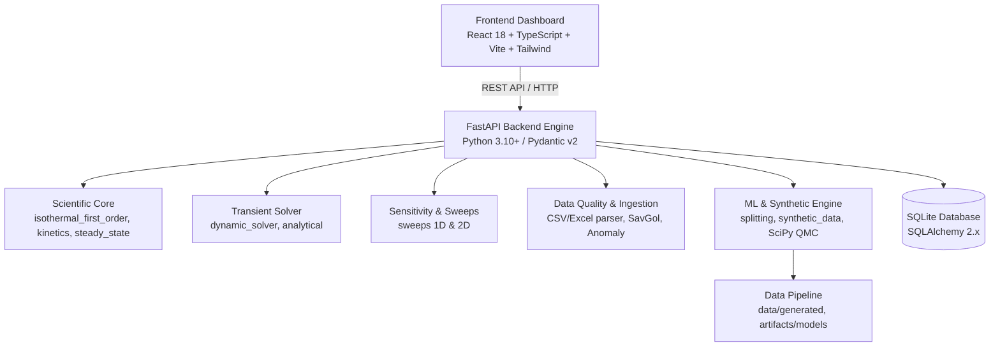

# CSTR Lab — System Architecture & Implementation Contract

## 1. System Architecture Overview

CSTR Lab is designed as an offline-first scientific computing and machine learning digital twin for Continuous Stirred-Tank Reactors. It adheres strictly to the canonical stack mandated in `GLOBAL-INSTRUCTIONS.md`:



---

## 2. Technology Stack & Component Separation

### Frontend Layer (`frontend/`)
- **Framework:** React 18 with TypeScript and Vite 5.
- **Styling:** Vanilla Tailwind CSS with custom theme design system; accessible layout with glassmorphic cards and crisp scientific telemetry.
- **Visualizations:** Plotly.js (`react-plotly.js` + `plotly.js-dist-min`) for responsive, interactive concentration trajectories, phase portraits, and 2D heatmap contour sweeps.
- **Routing:** `react-router-dom` with dedicated tabs for Simulation, Sensitivity Sweeps, Data Upload/Audit, Model Training, and Comparison.
- **Offline Reliability:** Zero third-party cloud CDN dependencies; bundled locally via Vite production build.

### Backend Layer (`backend/app/`)
- **Server:** FastAPI with Uvicorn; ASGI architecture.
- **Schema Validation:** Pydantic v2 with strict numerical boundary validators (rejecting `NaN`, `Inf`, and unphysical negative values).
- **Scientific Stack:**
  - `numpy`: Vectorized numerical operations and data structures.
  - `scipy.integrate.solve_ivp`: Dynamic ODE integration (`RK45`, `Radau`, `BDF`).
  - `scipy.optimize.minimize` / `curve_fit`: Non-linear least-squares kinetic parameter estimation.
  - `scipy.stats.qmc`: Latin Hypercube Sampling for parameter space exploration.
  - `pandas` & `openpyxl`: Ingestion and parsing of tabular datasets.
- **Persistence:** SQLite via SQLAlchemy 2.x; fully self-contained in a single local database file (`cstr_lab.db`).

---

## 3. Directory Layout & Governance

```
CSTR_model/
├── backend/
│   ├── app/
│   │   ├── api/             # FastAPI routers (simulations, sweeps, ingestion, ml)
│   │   ├── core/            # Mechanistic solvers, kinetics, splitting, synthetic data
│   │   ├── schemas/         # Pydantic request/response schemas
│   │   ├── config.py        # Environment settings (CORS, DB URL)
│   │   └── main.py          # Application root & CORS middleware
│   ├── tests/               # Pytest verification test suite
│   ├── pyproject.toml       # Test configuration and python packaging
│   └── requirements.txt     # Python backend dependencies
├── frontend/
│   ├── src/                 # React components, pages, api client, types
│   ├── package.json         # Frontend dependencies and npm scripts
│   └── vite.config.ts       # Vite bundler configuration
├── data/
│   ├── raw/                 # Read-only source datasets & manifest.json
│   ├── interim/             # Transformed intermediate clean files
│   ├── processed/           # Processed datasets ready for consumption
│   └── generated/           # Mechanistically generated synthetic data & splits
├── artifacts/
│   └── models/              # Saved model checkpoints, scalers, and ONNX weights
├── docs/                    # Architecture, baseline, governance, and status docs
├── reports/                 # Quality, coverage, and audit markdown reports
├── scripts/                 # Standalone auditing and data generation utilities
├── .env.example             # Safe environment template (no secrets)
├── GLOBAL-INSTRUCTIONS.md   # Universal engineering constraints
└── README.md                # Project master documentation
```

---

## 4. API & Data Contracts

All endpoints return strongly-typed JSON with explicit:
1. `units`: Clear mapping of all numerical fields to physical units (`L`, `L/min`, `min`, `mol/L`).
2. `provenance`: Distinction between `SIMULATION_ANALYTICAL`, `SIMULATION_NUMERICAL`, `EXPERIMENTAL_OBSERVED`, and `SYNTHETIC_MECHANISTIC_SOLVER`.
3. `diagnostics`: Material balance closure, solver status, error bounds, and numerical residuals.
4. `warnings`: Clear diagnostic warnings on boundary collisions, poor excitation, or unphysical extrapolations without throwing unhandled exceptions.

---

## 5. Security & Operational Policy

- **No Secrets in Source Control:** `.env.example` contains only localhost development defaults; secrets, API tokens, and credentials are never stored in git.
- **Input Guardrails:** All user and API inputs are validated for numerical sanity ($V > 0$, $Q > 0$, $k \ge 0$, $C_A \ge 0$, $t > 0$, no `NaN`/`Inf`).
- **Offline Simulation:** No external API keys or cloud services (Redis, AWS, OpenAI, etc.) are required to run the core application.
